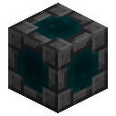
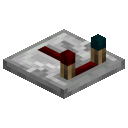
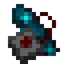
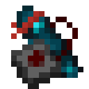
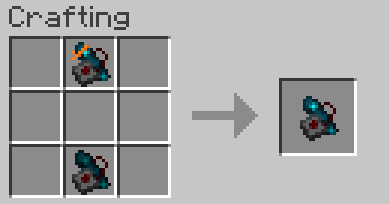
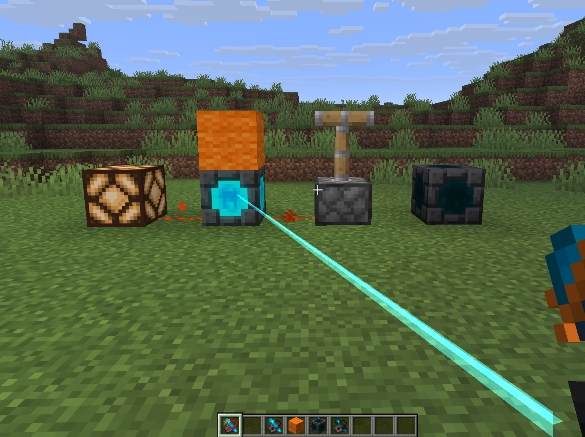

>[!NOTE]
>As of now, this mod is only available for **Fabric 26.3**

# Echo Expansions

A simple mod that aims to resolve my distaste for echo shards being a dead end crafting ingredient and fulfill my desperate need to have a garage door opener in Minecraft.

## Echo Entanglement

The mod centers around an added mechanic called echo entanglement. Echo Receivers are simple actuatable redstone sources that can be controlled by Echo Resonators and Echo Transmitters. 

- Linking a transmitter or resonator to a specific receiver is as easy as right clicking on the receiver with either in your hand.
- Links are same dimension only
- A transmitter passes on whatever signal strength reaches it, while a resonator always drives at full strength and overrides a weaker transmitter while held
- Transmitters keep their link when broken, so you can pick one up and replant it still bound

## Blocks & Items

| Name |                          Render                           | Usage                                                                                                                                                               |
| :--------- |:---------------------------------------------------------:|:--------------------------------------------------------------------------------------------------------------------------------------------------------------------|
| Echo Receiver |  | Actuatable redstone source. Can be controlled by resonators and transmitters. Breaking the receiver will break transmitter and resonator links.                     |
| Echo Transmitter |          | Link to a receiver. Can be placed and powered to deliver power to the receiver.                                                                                     |
| Echo Resonator |              | Link to a receiver. Consider it a simple remote control. Hold right click to deliver power to the receiver, let go to stop. Cooldown after right click is released. |

## Extras
| Name                  | Render | Usage                                                                                                                                                                                                                                                                                          |
|:----------------------| :------: |:-----------------------------------------------------------------------------------------------------------------------------------------------------------------------------------------------------------------------------------------------------------------------------------------------|
| Echo Resonator Ribbon |   | Combining a Echo Resonator with a piece of string in the crafting grid will tie a ribbon on the crystal. You can then dye this any color (leather dying system) as a nifty visual differentiator! If you want to get rid of it, just use shears in the crafting grid to remove it.             |
| Link Cloning |   | Put a linked Echo Resonator and a blank one anywhere in the crafting grid and the blank comes out bound to the same receiver, with your original handed straight back.                                                                                                                         |
| Entanglement Visuals |   | A beam runs from your hand to the receiver you are driving, and everyone nearby sees it. A linked resonator also lights its crystal whenever that receiver is live and in range, even when somebody else is the one powering it, so you can tell at a glance whether the door is already open. |

## Gamerules
Include the namespace `echo-expansions` in the command

| Name | Default | Range | Usage |
| :--------- |:-------:| :------: | :------------- |
| `echo_entanglement_range` |   64    | 1-256 | How far, in blocks, a resonator or transmitter can be from its linked receiver and still reach it. Measured from the holder for a resonator, and from the block itself for a transmitter. Also decides when a linked resonator shows its active state. |
| `echo_resonator_cooldown` |   30    | 1-1200 | How long, in ticks, a resonator and the receiver it reached are spent for after a use. |
| `echo_receiver_relocation` |  false  | true / false | Whether links follow a receiver that moves. Off, a receiver that turns up somewhere new counts as a copy and takes a fresh identity, leaving existing links pointed at the original. |

>[!NOTE]
>**LLM use disclosure.** Parts of this mod were written with a mix of locally hosted models, OpenAI models and Claude Opus 4-5.5. The design is mine, for better or worse. I have now written a functionally equivalent mod at least four times across Spigot and Fabric, a lot of the logic at play are direct descendants of those precursor plugins! Rest in peace, Redstone Remotes!